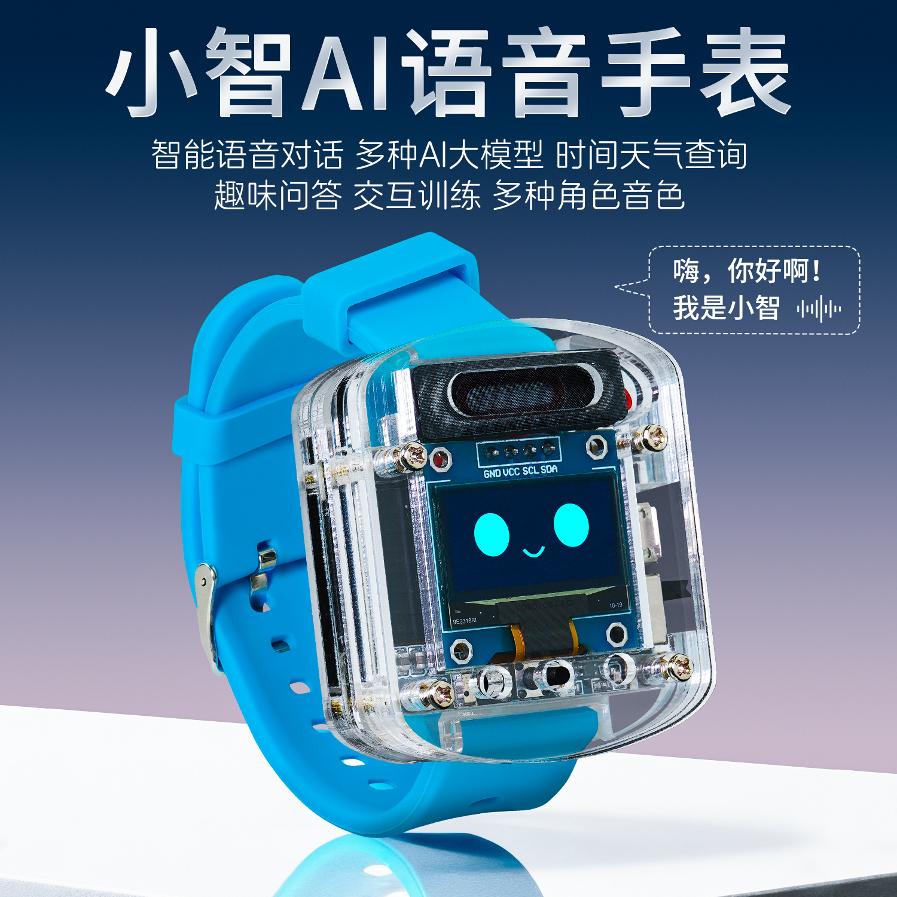

# HXFB-HU-087

<p align="center"></p>

Open documentation and test firmware for the **HXFB-HU-087** board, the ESP32-S3 inside the
"Xiaozhi AI voice watch" (小智AI语音手表) sold with the [xiaozhi](https://github.com/78/xiaozhi-esp32) firmware.
It has a 0.96" OLED, a PDM microphone, a speaker amplifier and a single button.

No schematic was published, so the pin map below was recovered from the stock firmware (see
[How the pin map was found](#how-the-pin-map-was-found)). The test firmware in [`test_firmware/`](test_firmware)
exercises every peripheral listed here and has been confirmed working on the hardware.

## Hardware

| Item          | Detail                                                    |
|---------------|-----------------------------------------------------------|
| SoC           | ESP32-S3 (chip revision v0.x)                             |
| Flash         | 16 MB, DIO, 80 MHz                                        |
| PSRAM         | Stock firmware is built with PSRAM support; size not confirmed |
| Display       | SSD1306 OLED, 128×64, I2C                                 |
| Microphone    | PDM digital microphone                                    |
| Speaker       | I2S class-D amplifier (MAX98357-style) with enable pin    |
| Button        | One user button                                           |
| USB           | No USB-serial chip; program over UART0                    |

## Pin map

| Function              | GPIO   | Notes                                              |
|-----------------------|--------|----------------------------------------------------|
| OLED SDA              | **41** | I2C, address `0x3C`, 400 kHz                       |
| OLED SCL              | **42** |                                                    |
| OLED RESET            | —      | not connected                                      |
| Speaker BCLK          | **15** | I2S, standard (Philips) format                     |
| Speaker WS / LRCK     | **16** |                                                    |
| Speaker DATA (DOUT)   | **7**  |                                                    |
| Amplifier enable      | **17** | output, **high = on**                              |
| Microphone CLK        | **5**  | PDM                                                |
| Microphone DATA       | **6**  | PDM                                                |
| Button                | **18** | **active low**, use the internal pull-up           |
| UART0 TX / RX         | 43 / 44 | ESP32-S3 defaults, used for flashing and logs     |
| BOOT strap            | 0      | hold low at reset for download mode                |

GPIO4 is passed to the stock audio driver as the microphone "WS" pin but is not used, because a PDM
microphone has no word-select line. Treat it as unconnected unless you confirm otherwise.

## Peripheral notes

### Display
- SSD1306 controller, 128×64, I2C address `0x3C`, no reset line.
- The stock firmware mirrors **both X and Y** (`esp_lcd_panel_mirror(panel, true, true)`). Without that,
  the image is upside down.
- With ESP-IDF's `esp_lcd` I2C panel IO, use `control_phase_bytes = 1`, `dc_bit_offset = 6`, 8-bit commands
  and parameters.

### Microphone
- PDM microphone. On the ESP32-S3, PDM input is only available on **I2S0**.
- The stock firmware samples it at **24 kHz**, 16-bit mono. That gives a 1.536 MHz PDM clock.
  Much lower sample rates can push the clock below what the microphone accepts.
- The samples carry a DC offset, so apply a high-pass filter.

### Speaker
- Standard I2S on **I2S1**: 24 kHz, 32-bit, Philips format, mono.
- GPIO17 powers the amplifier. The stock firmware drives it **low** at boot, **high** when audio output is
  enabled, and **low** again whenever the microphone is listening, so the speaker never runs while it
  records. Keep it low when not playing to avoid hiss and save power.

### Button
- GPIO18 to ground. Pressed = `0`. The stock firmware uses it for click, long press, press and release.

## Stock firmware

| Item          | Value                                                         |
|---------------|---------------------------------------------------------------|
| Project       | `xiaozhi` v1.5.6, board `hxfb-hu-087`                         |
| Built         | 2025-11-13 with ESP-IDF v5.4.1                                |
| Active app    | `ota_0`                                                       |

Stock partition table:

| Name     | Type | SubType  | Offset     | Size     |
|----------|------|----------|------------|----------|
| nvs      | data | nvs      | 0x9000     | 16 KB    |
| otadata  | data | ota      | 0xD000     | 8 KB     |
| phy_init | data | phy      | 0xF000     | 4 KB     |
| model    | data | 0x82     | 0x10000    | 960 KB (speech models, wake word) |
| ota_0    | app  | ota_0    | 0x100000   | 6 MB     |
| ota_1    | app  | ota_1    | 0x700000   | 6 MB     |

**Back up the full flash before writing anything.** Once overwritten, the stock firmware can't be
downloaded again.

```
esptool --chip esp32s3 -p PORT -b 460800 read-flash 0 0x1000000 hu087_stock.bin
```

To restore it later:

```
esptool --chip esp32s3 -p PORT -b 460800 write-flash 0 hu087_stock.bin
```

## Flashing

The board has no USB-serial converter. Use a 3.3 V USB-UART adapter:

| Adapter | Board          |
|---------|----------------|
| TX      | U0RXD (GPIO44) |
| RX      | U0TXD (GPIO43) |
| GND     | GND            |

To enter download mode, hold GPIO0 (BOOT) low while resetting or powering the board, then release it.
The ROM then prints `waiting for download`.

## Test firmware

[`test_firmware/`](test_firmware) is a minimal ESP-IDF project with no WiFi and no OTA.

- The OLED shows the live microphone waveform, auto-scaled.
- Hold the button to record, up to **2 seconds**. The status line shows `REC` and a progress bar.
- **200 ms** after you release the button, or when the 2 s run out, the recording plays back on the speaker,
  normalized in volume. The status line shows `PLAY`.

If the waveform moves when you speak, the microphone works. The status line changing shows the button
works. Hearing your voice shows the speaker and amplifier work.

Build (ESP-IDF v6.1, older 5.x releases should work too):

```
cd test_firmware
idf.py set-target esp32s3
idf.py build
idf.py -p PORT flash monitor
```

The test firmware uses its own partition table (one factory app). To go back to the stock firmware,
restore the full backup.

## How the pin map was found

All values come from disassembling the stock application image, taken from the `ota_0` partition of a full
flash dump.

1. The ESP image was converted to ELF and disassembled with `xtensa-esp32s3-elf-objdump`.
2. The board's init functions were located through the assert strings the firmware still contains, such as
   `gpio_set_level(SPK_CTRL_GPIO, 0)`, `esp_lcd_new_panel_io_i2c_v2(...)` and
   `HXFB_NoAudioCodecSimplex::HXFB_NoAudioCodecSimplex(...)`.
3. The constants were read from the arguments those functions pass to `i2c_new_master_bus`, `gpio_config`,
   `Button(18)`, `i2s_channel_init_std_mode` and `i2s_channel_init_pdm_rx_mode`.

Not investigated yet:
- battery or charge sensing (the firmware links ADC code, but no board-specific use was confirmed)
- PSRAM size and mode
- any pins not used by the stock firmware

Contributions are welcome.

## License

[MIT](LICENSE)
